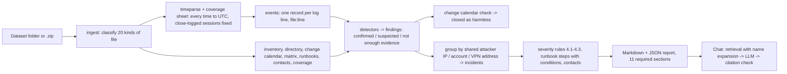

# Orbit Triage - Security Incident Triage Assistant

Tech Fusion '26 AI Hackathon - **Problem Statement C**.

Reads Orbit Logistics' security logs and reference files, rebuilds what happened in UTC,
matches the same machine/person across files, closes approved activity with its change ID,
scores severity from the matrix, picks actions only from the runbooks, and writes an incident
report with the 11 sections that the security rules (section 7) require. Every fact cites
`file:line`. A chat panel answers follow-up questions; every citation it gives is checked.

## Quick start

```bash
pip install -r requirements.txt
python -m triage data -o incident_report.md --json analysis.json   # CLI report
uvicorn app.main:app --port 8000                                    # web app -> http://localhost:8000
```

Docker (use this if the app is not hosted):

```bash
cp .env.example .env          # optional: GROQ_API_KEY and/or OPENROUTER_API_KEY for the chat
docker compose up --build     # -> http://localhost:8000
```

Hosting: Vercel/Netlify suit static sites, not a long-running Python server. Deploy the Dockerfile to
Render (`render.yaml` included, free plan), Railway, Fly.io or Hugging Face Spaces (Docker).

`data/` holds the 20 base files from the organiser repo. Any other dataset can be uploaded as a
`.zip` in the web app or passed to the CLI. `samples/synthetic/` is a second, differently formatted
dataset used to check that nothing is hard-coded to one set of files.

## What it finds in the base files

| Incident | Severity | What happened |
|---|---|---|
| INC-01 | **P1** | Phishing email from look-alike `orbit-logistlcs.example` (score 6.2 < 8.0 quarantine threshold) -> amalik's laptop LT-FIN-014 connects to 198.51.100.77, which the IDS says hosts the link domain -> 4 rejected MFA pushes then an approved one from RO, from that same IP (rule 6.1) -> VPN address 10.10.3.45 -> Kerberos tickets for FS01 and DB01 -> 2.41 GB from SRV-FS01 over SMB (06:03:12 to 06:21:19 UTC) -> password changed by the attacker -> real user locked out |
| INC-02 | **P2** | sqlmap SQL injection on SRV-WEB01; one `UNION SELECT ... FROM users` request got HTTP 200 / 48,213 bytes while the others got 500 / 612 bytes -> success suspected (RB-WEB-03 step 3) |
| INC-03 | **P3** | utariq: VPN session from 182.180.44.12 open 02:58 to 10:15 UTC while he logged in at LT-WH-021 in the office at 04:15 (rule 6.2, suspected only). The phishing email came later, so it is not the cause |
| INC-04 | **P4** | External port scan + `/admin`, `/.env` probes from 192.0.2.88 against SRV-WEB01 |
| closed | - | SCAN01 scan: CHG-2026-1104-02 (21:00 to 23:00 PKT = 16:00 to 18:00 UTC, subnets in scope) |
| closed | - | braza RDP to SRV-DC01 "outside office hours": CHG-2026-1104-03 |

Traps it handles: IDS alert times in UTC vs. the calendar in PKT; the internal firewall logging at
session **close** (start = close - duration); the perimeter firewall logging at **start** (so its 9 MB
does not contradict the 2.4 GB); the postponed CHG-2026-1104-05 and the nightly backup CHG-01 do NOT
explain anything; the internal firewall gap 06:32 to 07:28 UTC falls inside the attack and has no
change entry; Kerberos traffic to SRV-DC01 is not counted as reaching the Critical DC (rule 4.1;
the report shows that the result would be P1 either way); "stolen" is never written (rule 2.4).

## How each requirement is met

| Requirement | How |
|---|---|
| 1. Timeline, time zones, file and line | `timeparse.py` reads ISO (Z / offset / `UTC` / `PKT`), Apache, slash dates, syslog, epoch. A log's zone comes from a `timezones.json` override, a header comment, or **the row in the coverage sheet that names the file** (e.g. "Local time PKT, UTC+5"). The same row says whether a device logs when a session starts or closes; close-logged sessions are moved back by their duration. Every event keeps its original timestamp text and `file:Lnn`; the timeline also shows PKT in brackets (rule 1.1). |
| 2. Source, accounts, assets, criticality, severity | Detectors (`detect.py`): MFA fatigue / brute force -> credential compromise with VPN session follow-up; phishing with click detection through the firewall; port scans; web attacks with success detection from response size; large transfers (direction-aware: `bytes_server_to_client`, VPN `bytes_to_client`); privileged remote desktop; two logins at once (rule 6.2). Severity follows rules 4.1 to 4.3: most critical asset actually reached per part, highest part wins, unrelated incidents scored separately. Every step is cited. |
| 3a. Same thing, different names | `entities.py`: hostname = IP(s) incl. public IP = asset tag; `SRV-` prefix dropped (`DC01`, `vpn01`); internal DNS domain from the inventory note (`cifs/FS01.orbit.local` -> SRV-FS01); `ORBIT\amalik` -> amalik -> Ayesha Malik -> laptop A-2014 -> LT-FIN-014 -> 10.20.5.14 (directory + inventory + DHCP); VPN address leases (10.10.3.45 = session VS-20433 of amalik from 198.51.100.77). Each match is written out with the lines that prove it. |
| 3b. Noise vs attack | A finding is closed only when a change names the same person/tool, has an approved status, a window (converted to UTC) that contains the activity, and a scope (names or CIDR subnets) covering every system involved (rule 3.1). Changes on the same systems that do not match are listed with the reason, so nobody closes the incident by mistake. |
| 3c. No over-claiming | Claims are typed when created: Confirmed (a line shows it), Suspected (the guess is written out, rule 2.2), Not enough evidence. |
| 3d. Missing data | Coverage-sheet gaps (converted to UTC) and "sources that do not exist" are parsed, attached to the incidents they overlap, and explained (a close-logged device loses every session that ended in its gap). Silent regular streams (heartbeats) are also detected. |
| 4. Actions, contacts, report | Runbooks are parsed into numbered steps; each step is quoted with its `file:line`, filled with the concrete account/IP/host/phone, and its "If ..." condition is evaluated from the evidence (e.g. RB-EXFIL-04 step 5: audit log does not exist -> record that the files read are unknown). Contacts come from the escalation sheet, with "data owner" resolved from the inventory (Saima Noor) and "if finance/HR data" checked against the asset type. |

## Architecture



Facts are decided by deterministic code, not by the LLM, so results are repeatable, fast, free
and cannot be invented. The LLM (Groq first, OpenRouter second) answers free-form follow-up
questions on top of the analysis; any `[file:Lnn]` that does not exist is removed and the answer
flagged. Without a key, the chat answers from the analysis and the best-matching lines.

**Rate limits and errors:** client-side limiter (`LLM_RPM`), `Retry-After` honoured on 429,
exponential backoff with jitter, fall-through to the next provider, deterministic answer if all
fail. A bad log line never stops a run; skipped lines are listed in the analyst notes. Uploads are
size-capped and protected against zip-slip.

## API

| Method | Path | Purpose |
|---|---|---|
| GET | `/api/analyze?dataset=default` | Full analysis JSON + Markdown report |
| POST | `/api/upload` | Multipart: one `.zip` or many files; returns analysis + `dataset_id` |
| POST | `/api/ask` | `{"question": "...", "dataset": "default", "history": []}` |
| GET | `/api/report.md` | Download the report |
| GET | `/api/health` | Which LLM providers are configured |

## Tests and evaluation

```bash
pytest -q                 # 41 tests: every timestamp format, close-time logging, all 4 incidents and severities,
                          # click detection, alias matching, both closures, traps, conditions, contacts,
                          # and 6 "change the files, the answer must follow" cases
python eval/run_eval.py   # 15 trick questions ("was data stolen?", "the gap means nothing happened?", ...)
```

## Known failure cases

- **Time zones nobody wrote down.** If neither the log, the coverage sheet nor a policy states the
  zone, UTC is assumed and flagged in the analyst notes.
- **Rule-based detection.** Attacks outside the detectors (malware without EDR logs, slow
  exfiltration under 500 MB, password spraying over many hours) are not found. Thresholds are
  env vars (`TRIAGE_FAIL_THRESHOLD`, `TRIAGE_MFA_FAIL_THRESHOLD`, `TRIAGE_SCAN_PORTS`, `TRIAGE_EXFIL_BYTES`).
- **What counts as "reaching" an asset (rule 4.1)** is a judgement: Kerberos / directory traffic to
  a domain controller is not counted. The report states the alternative severity when it differs.
- **Grouping** uses shared attacker IP, account or VPN address. Two attackers sharing one
  address would be merged; one attacker changing every identifier would be split.
- **Runbook conditions** are checked with keyword rules; an unusual wording is shown as
  "condition: check" rather than guessed.
- **Chat without an API key** returns ranked facts, not reasoning: 13/15 trick questions pass in
  that mode (cross-file "how do you know" and prompt-injection questions need the LLM).

## Extra features

Alert triage table (every IDS alert -> incident or closure), web UI with severity cards, PKT
next to UTC, three-column evidence view and chat, `.zip` upload, downloadable report, JSON output,
runbook condition checks, contact resolution, "changes checked but not matching" list, firewall
reboot vs. change calendar check, timezone override file, CLI, Docker + Render config, tests, eval.

## Project layout

```
triage/   ingest timeparse events entities coverage reference detect gaps pipeline report llm qa
app/      main.py (FastAPI)  static/index.html (UI)
data/     the 20 base files from the organiser repo
samples/  synthetic/ - a second dataset with other formats (robustness check)
eval/     trick questions + runner
tests/    pytest suite
```
